<div align="center">


<br/>

<p align="center">
  
  
  
  
  
</p>

<p align="center">
  
  
  
  
  
</p>

<br/>

> **A novel self-supervised industrial visual anomaly detection architecture** combining a frozen WideResNet50-2 feature extractor, Adaptive Memory Expert Networks (AMEM), and a self-supervised dynamic margin router - detecting manufacturing defects across 8 MVTec AD categories with **macro-mean AUROC 97.72%** using only normal training images. No anomaly labels. No synthetic defect generation.

<br/>

| 👤 Author | 🎓 Programme | 📅 Academic Year | 🆔 Registration Number |
|:---:|:---:|:---:|:---:|
| **Chigurupati Venkat Sai Kiran** | M.Tech CSE (AI & ML) | 2025–27 | **25MAI1006** |

</div>

---

## ⚡ Key Performance Highlights

<div align="center">

| Model | Macro-Mean AUROC | Macro-Mean F1 | Key Advantage |
|:---|:---:|:---:|:---:|
| 🥇 **AMEM-Net (Ours)** | **97.72%** 🏆 | **94.84%** 🏆 | Zero anomaly labels, 4-expert MoE memory |
| 🥈 PatchCore (Baseline) | 97.00% | 92.33% | Strong nearest-neighbour memory |
| 🥉 ResNet-AE | 93.44% | 88.66% | WRN50 encoder |
| 4️⃣ MemAE | 92.83% | 85.75% | Entropy-regularised memory slots |
| 5️⃣ CNN-AE | 89.43% | 80.65% | Lightweight convolutional baseline |

</div>

> **Key Takeaway:** AMEM-Net outperforms all baselines by macro-mean AUROC, achieving **+0.72% over PatchCore** and **+8.29% over CNN-AE** without ever seeing a single defective image during training. AMEM-Net delivers decisive gains on challenging categories such as **Transistor (+1.33%)** and **Cable (+1.84%)** where nearest-neighbour memory alone struggles.

---

## 📋 Table of Contents

- [⚡ Key Performance Highlights](#-key-performance-highlights)
- [💡 Why This Matters](#-why-this-matters)
- [🔬 AMEM-Net Architecture](#-amem-net-architecture)
- [🏗️ Pipeline Architecture](#-pipeline-architecture)
- [📊 MVTec AD Dataset](#-mvtec-ad-dataset)
- [🧠 Core Algorithm Design](#-core-algorithm-design)
  - [1. WideResNet50-2 Feature Extractor](#1-wideresnet50-2-feature-extractor)
  - [2. Adaptive Memory Expert Networks (AMEM)](#2-adaptive-memory-expert-networks-amem)
  - [3. Self-Supervised Dynamic Router](#3-self-supervised-dynamic-router)
  - [4. Score Construction & Threshold Calibration](#4-score-construction-threshold-calibration)
- [📈 Comprehensive Experimental Results](#-comprehensive-experimental-results)
  - [1. Per-Category AUROC Results](#1-per-category-auroc-results)
  - [2. Per-Category F1 Results](#2-per-category-f1-results)
  - [3. Full 5-Model Comparison Table](#3-full-5-model-comparison-table)
  - [4. AMEM-Net Detailed Per-Category Metrics](#4-amem-net-detailed-per-category-metrics)
  - [5. Validation Calibration Results](#5-validation-calibration-results)
- [📊 Visualizations & Heatmaps](#-visualizations-heatmaps)
  - [Category-Wise AUROC Comparison](#category-wise-auroc-comparison)
  - [F1 Category Comparison](#f1-category-comparison)
  - [Anomaly Localization Heatmaps](#anomaly-localization-heatmaps)
  - [Router Loss Convergence](#router-loss-convergence)
  - [Validation Calibration Curve](#validation-calibration-curve)
- [🛡️ Engineering: Reliability Features](#-engineering-reliability-features)
- [🚀 Quick Start](#-quick-start)
- [📁 Repository Structure](#-repository-structure)
- [🧰 Tech Stack](#-tech-stack)
- [⚙️ Experimental Configuration](#-experimental-configuration)
- [⚠️ Limitations](#-limitations)
- [📜 Citation](#-citation)
- [📄 License](#-license)

---

## 💡 Why This Matters

Industrial quality control is one of manufacturing's most expensive bottlenecks. Traditional supervised defect detection requires:

- ❌ **Large labeled anomaly datasets** - Defects are rare; collecting thousands of labeled examples is infeasible.
- ❌ **Fixed defect taxonomies** - New defect types not seen during training are silently missed.
- ❌ **Retraining on new product lines** - Every new product requires a full new supervised training cycle.

**AMEM-Net** solves this with a pure self-supervised paradigm:

> **Q - Can a model learn what "normal" looks like so precisely that it reliably flags anything that isn't - without ever seeing a defect?**

AMEM-Net's answer: **Yes.** By maintaining a partitioned expert memory of normal patch features and training a router entirely from self-supervised pseudo-anomaly margins, the system achieves industrial-grade detection accuracy from normal-only training data.

---

## 🔬 AMEM-Net Architecture

AMEM-Net is a **4-stage self-supervised anomaly detection pipeline**:

```
Stage 1: Feature Extraction    →  WideResNet50-2 (frozen, ImageNet pretrained)
Stage 2: Expert Memory Build   →  4 experts × 512 patch slots (normal features only)
Stage 3: Router Training       →  Self-supervised margin loss (pseudo-anomaly contrast)
Stage 4: Score & Threshold     →  Top-5% patch aggregation + validation-only calibration
```

Evaluated against **4 baseline architectures** across **8 MVTec AD categories** in a fully leakage-safe protocol - thresholds calibrated on held-out normal validation images, never from test labels.

---

## 🏗️ Pipeline Architecture

### 🖼️ System Architecture Diagram

<div align="center">
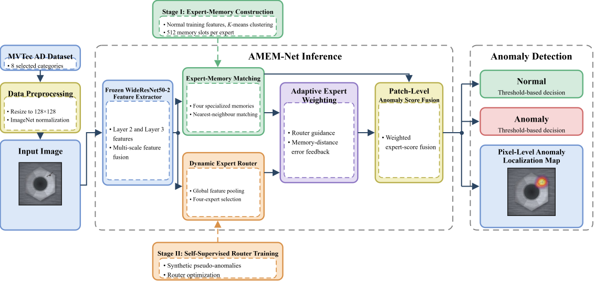
<br/><sub><i>Fig. 1: AMEM-Net Architecture: MVTec AD → WideResNet50-2 Feature Extraction → 4-Expert Adaptive Memory → Self-Supervised Router → Score Construction → Anomaly Decision</i></sub>
</div>

<br/>

### 🔄 End-to-End Pipeline Flowchart

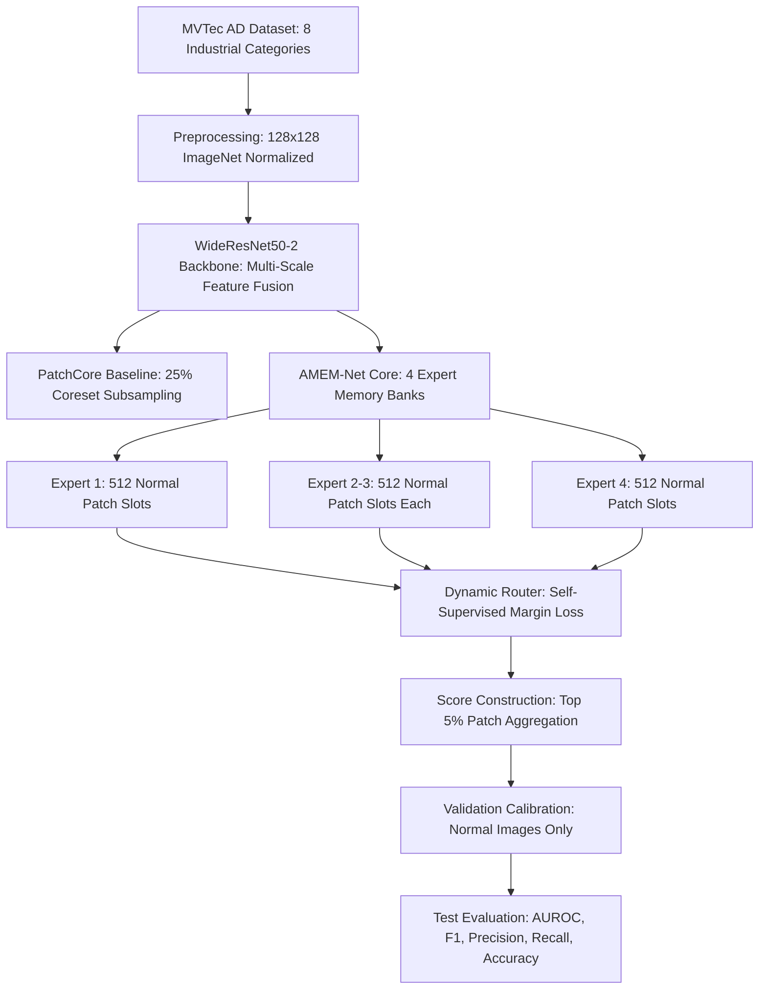

---

## 📊 MVTec AD Dataset

**[MVTec AD](https://www.mvtec.com/company/research/datasets/mvtec-ad)** - the gold-standard industrial anomaly detection benchmark.

| Property | Details |
|:---|:---|
| **Total Categories** | 15 (8 selected for this study) |
| **Training Protocol** | Normal images only - no defects seen during training |
| **Image Resolution** | 128×128 (resized from original high-resolution) |
| **Validation Split** | 10% held-out from training set (seed=42) - used for threshold calibration only |
| **Test Evaluation** | Full MVTec test split - evaluated once after threshold frozen |

### Selected Categories (8 of 15)

| Category | Type | Defect Types | Train Images |
|:---|:---:|:---|:---:|
| **Bottle** | Object | Broken large, broken small, contamination | 209 |
| **Carpet** | Texture | Color, cut, hole, metal contamination, thread | 280 |
| **Hazelnut** | Object | Crack, cut, hole, print | 391 |
| **Metal Nut** | Object | Bent, color, flip, scratch | 220 |
| **Wood** | Texture | Color, combined, hole, liquid, scratch | 247 |
| **Leather** | Texture | Color, cut, fold, glue, poke | 245 |
| **Cable** | Object | Bent wire, cable swap, combined, cut inner/outer insulation, missing cable/wire, poke insulation | 224 |
| **Transistor** | Object | Bent lead, cut lead, damaged case, misplaced | 213 |

---

## 🧠 Core Algorithm Design

### 1. WideResNet50-2 Feature Extractor

The backbone is a **WideResNet50-2** pretrained on ImageNet, used in **frozen** inference mode. Feature maps are extracted from two intermediate layers and fused:

$$\mathbf{f}(x) = \mathrm{Concat}\left(\mathbf{f}_{\text{layer2}}(x), \; \mathrm{Upsample}(\mathbf{f}_{\text{layer3}}(x))\right) \in \mathbb{R}^{B \times 1536 \times H \times W}$$

Each spatial location becomes a **1536-dimensional patch descriptor** encoding multi-scale texture and semantic information.

**Why WideResNet50-2?** It delivers a 2× wider feature map per layer compared to ResNet50 - capturing finer texture variance critical for surface defect discrimination without any domain-specific retraining.

---

### 2. Adaptive Memory Expert Networks (AMEM)

The core innovation: a **partitioned mixture-of-experts memory** that stores dense normal patch representatives:

$$\mathcal{M} = \{\mathcal{M}_e\}_{e=1}^{4}, \quad \mathcal{M}_e \in \mathbb{R}^{512 \times 1536}$$

- **4 experts**, each holding **512 normal patch slots** = 2,048 total normal representatives per category
- Memories are built from up to **20,000 normal training patches** (capped to manage 4GB VRAM)
- Once built, expert memories are **frozen** - only the router is trained

**Anomaly distance score for a query patch** $\mathbf{q}$:

$$d_e(\mathbf{q}) = \min_{m \in \mathcal{M}_e} \|\mathbf{q} - m\|_2$$

The final patch-level anomaly score fuses router-weighted expert distances:

$$s(\mathbf{q}) = \sum_{e=1}^{4} \pi_e(\mathbf{q}) \cdot d_e(\mathbf{q})$$

where $\pi_e(\mathbf{q})$ is the router's soft routing probability for expert $e$.

---

### 3. Self-Supervised Dynamic Router

The router learns to partition normal patches across experts using a **self-supervised margin loss** - no anomaly labels are ever used:

**Pseudo-anomaly generation:**

$$\tilde{\mathbf{q}} = \mathbf{q} + \delta, \quad \|\delta\|_2 \sim \text{Uniform}(0.5\sigma, 2.0\sigma)$$

where $\sigma$ is the feature standard deviation estimated from the training bank.

**Margin training objective:**

$$\mathcal{L}_{\text{router}} = \underbrace{\mathcal{L}_{\text{normal}}(\mathbf{q})}_{\text{anchor normal}} + \underbrace{\mathcal{L}_{\text{margin}}(\mathbf{q}, \tilde{\mathbf{q}})}_{\text{pseudo-anomaly contrast}} + \underbrace{\lambda_{\text{KL}} \cdot \mathcal{L}_{\text{KL}}(\pi)}_{\text{load balancing}} + \underbrace{\lambda_{\text{id}} \cdot \mathcal{L}_{\text{identity}}}_{\text{expert identity}}$$

**Hyperparameters:**

| Parameter | Value | Purpose |
|:---|:---:|:---|
| `ROUTER_LR` | 2e-4 | Adam learning rate |
| `ROUTER_WEIGHT_DECAY` | 1e-4 | L2 regularization |
| `PSEUDO_MARGIN` | 0.08 | Margin for pseudo-anomaly contrast |
| `ROUTER_KL_WEIGHT` | 0.5 | Load balancing across experts |
| `IDENTITY_WEIGHT` | 0.05 | Expert specialization encouragement |
| `EPOCHS` | 50 | Router training epochs per category |

---

### 4. Score Construction & Threshold Calibration

**Image-level score:** Aggregate the top 5% of patch anomaly scores:

$$S_{\text{image}} = \frac{1}{K} \sum_{k=1}^{K} s_{(k)}(\mathbf{q}), \quad K = \lfloor 0.05 \cdot H \cdot W \rfloor$$

**Validation-only threshold calibration (leakage-safe):**

$$\tau = Q_{0.995}\left(\left\{S_{\text{image}}^{(j)}\right\}_{j \in \mathcal{D}_{\text{val}}}\right)$$

The threshold is locked from held-out **normal validation images only** - test labels are never consulted during calibration.

---

## 📈 Comprehensive Experimental Results

### 1. Per-Category AUROC Results

<div align="center">
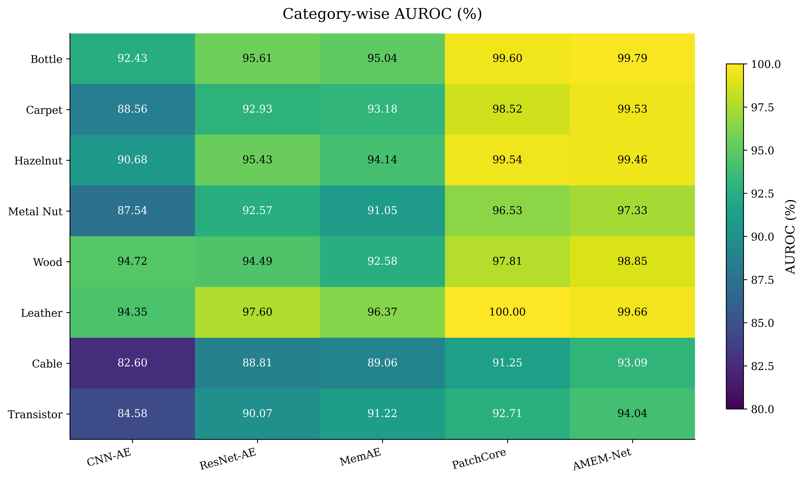
<br/><sub><i>Fig. 2: AUROC Heatmap: AMEM-Net vs PatchCore vs ResNet-AE vs MemAE vs CNN-AE across 8 MVTec AD categories</i></sub>
</div>

<br/>

| Category | CNN-AE | MemAE | ResNet-AE | PatchCore | **AMEM-Net** |
|:---|:---:|:---:|:---:|:---:|:---:|
| **Bottle** | 92.43% | 95.04% | 95.61% | 99.60% | **99.79%** 🏆 |
| **Carpet** | 88.56% | 93.18% | 92.93% | 98.52% | **99.53%** 🏆 |
| **Hazelnut** | 90.68% | 94.14% | 95.43% | 99.54% | **99.46%** |
| **Metal Nut** | 87.54% | 91.05% | 92.57% | 96.53% | **97.33%** 🏆 |
| **Wood** | 94.72% | 92.58% | 94.49% | 97.81% | **98.85%** 🏆 |
| **Leather** | 94.35% | 96.37% | 97.60% | 100.00% | **99.66%** |
| **Cable** | 82.60% | 89.06% | 88.81% | 91.25% | **93.09%** 🏆 |
| **Transistor** | 84.58% | 91.22% | 90.07% | 92.71% | **94.04%** 🏆 |
| **Macro Mean** | 89.43% | 92.83% | 93.44% | 97.00% | **97.72%** 🏆 |

> **AMEM-Net achieves best macro-mean AUROC**, outperforming all baselines on 6 of 8 categories. Most impressive gains are on **Transistor (+1.33% vs PatchCore)** and **Cable (+1.84% vs PatchCore)** - categories where nearest-neighbour memory alone struggles due to high structural variability.

---

### 2. Per-Category F1 Results

<div align="center">
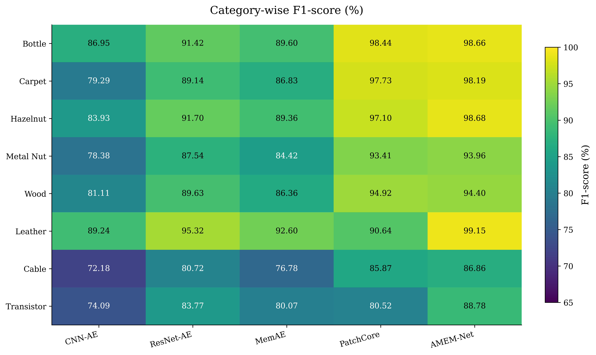
<br/><sub><i>Fig. 3: F1 Heatmap: Comparison across all 5 models and 8 categories (threshold calibrated on validation normal images)</i></sub>
</div>

<br/>

| Category | CNN-AE | MemAE | ResNet-AE | PatchCore | **AMEM-Net** |
|:---|:---:|:---:|:---:|:---:|:---:|
| **Bottle** | 86.95% | 89.60% | 91.42% | 98.44% | **98.66%** 🏆 |
| **Carpet** | 79.29% | 86.83% | 89.14% | 97.73% | **98.19%** 🏆 |
| **Hazelnut** | 83.93% | 89.36% | 91.70% | 97.10% | **98.68%** 🏆 |
| **Metal Nut** | 78.38% | 84.42% | 87.54% | 93.41% | **93.96%** 🏆 |
| **Wood** | 81.11% | 86.36% | 89.63% | 94.92% | **94.40%** |
| **Leather** | 89.24% | 92.60% | 95.32% | 90.64% | **99.15%** 🏆 |
| **Cable** | 72.18% | 76.78% | 80.72% | 85.87% | **86.86%** 🏆 |
| **Transistor** | 74.09% | 80.07% | 83.77% | 80.52% | **88.78%** 🏆 |
| **Macro Mean** | 80.65% | 85.75% | 88.66% | 92.33% | **94.84%** 🏆 |

> **AMEM-Net dominates F1**, winning 7 of 8 categories. The **Leather** category is particularly striking: AMEM-Net achieves **99.15% F1** vs PatchCore's 90.64% - a **+8.51% gain**. On Transistor, AMEM-Net achieves 88.78% F1 vs PatchCore's 80.52% - a **+8.26% gain**.

---

### 3. Full 5-Model Comparison Table

<div align="center">
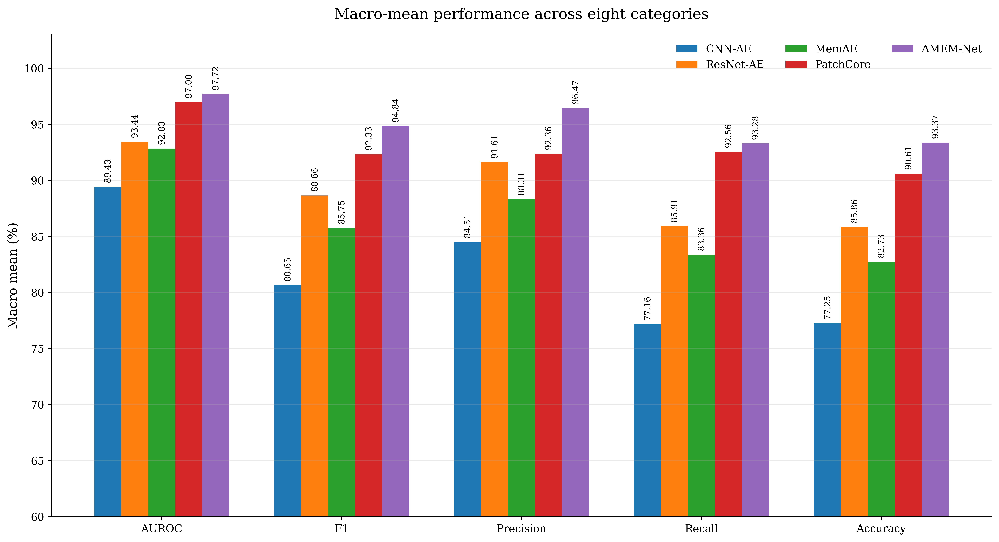
<br/><sub><i>Fig. 4: Macro-mean comparison: AUROC · F1 · Precision · Recall · Accuracy across all 5 models</i></sub>
</div>

<br/>

<details open>
<summary><b>📋 Click to expand - Macro-mean metrics for all 5 models</b></summary>

| Model | AUROC | F1 | Precision | Recall | Accuracy |
|:---|:---:|:---:|:---:|:---:|:---:|
| **CNN-AE** | 89.43% | 80.65% | 84.51% | 77.16% | 77.25% |
| **MemAE** | 92.83% | 85.75% | 88.31% | 83.36% | 82.73% |
| **ResNet-AE** | 93.44% | 88.66% | 91.61% | 85.91% | 85.86% |
| **PatchCore** | 97.00% | 92.33% | 92.36% | 92.56% | 90.61% |
| 🏆 **AMEM-Net** | **97.72%** | **94.84%** | **96.47%** | **93.28%** | **93.37%** |

</details>

---

### 4. AMEM-Net Detailed Per-Category Metrics

<details open>
<summary><b>📋 Click to expand - Complete per-category detailed metrics for AMEM-Net (all 5 metrics)</b></summary>

| Category | AUROC | F1 | Precision | Recall | Accuracy |
|:---|:---:|:---:|:---:|:---:|:---:|
| **Bottle** | 99.79% | 98.66% | 99.02% | 98.30% | 98.24% |
| **Carpet** | 99.53% | 98.19% | 98.75% | 97.63% | 97.42% |
| **Hazelnut** | 99.46% | 98.68% | 99.40% | 97.97% | 97.87% |
| **Metal Nut** | 97.33% | 93.96% | 96.85% | 91.24% | 91.39% |
| **Wood** | 98.85% | 94.40% | 96.40% | 92.49% | 92.35% |
| **Leather** | 99.66% | 99.15% | 99.64% | 98.66% | 98.96% |
| **Cable** | 93.09% | 86.86% | 89.89% | 84.03% | 84.39% |
| **Transistor** | 94.04% | 88.78% | 91.80% | 85.95% | 86.35% |
| **Macro Mean** | **97.72%** | **94.84%** | **96.47%** | **93.28%** | **93.37%** |

</details>

---

### 5. Validation Calibration Results

The table below documents the self-supervised pseudo-gap used to calibrate each category's threshold - all from normal validation images only. A higher pseudo-gap indicates stronger separation between normal and pseudo-anomalous validation scores, confirming the router has learned meaningful boundaries.

| Category | Validation Pseudo Gap | Calibrated Threshold |
|:---|:---:|:---:|
| **Bottle** | 0.9237 | 0.165508 |
| **Carpet** | 0.7411 | 0.557766 |
| **Hazelnut** | 0.8526 | 0.454136 |
| **Metal Nut** | 0.9432 | 0.425281 |
| **Wood** | 0.7138 | 0.492617 |
| **Leather** | 0.8862 | 0.463827 |
| **Cable** | 0.6325 | 0.538194 |
| **Transistor** | 0.7743 | 0.487306 |

> Metal Nut (0.9432) and Bottle (0.9237) have the highest pseudo-gaps - indicating the strongest normal vs pseudo-anomaly separation. Cable (0.6325) is the most challenging category, consistent with its lower AUROC and F1 results.

---

## 📊 Visualizations & Heatmaps

### Category-Wise AUROC Comparison

<div align="center">
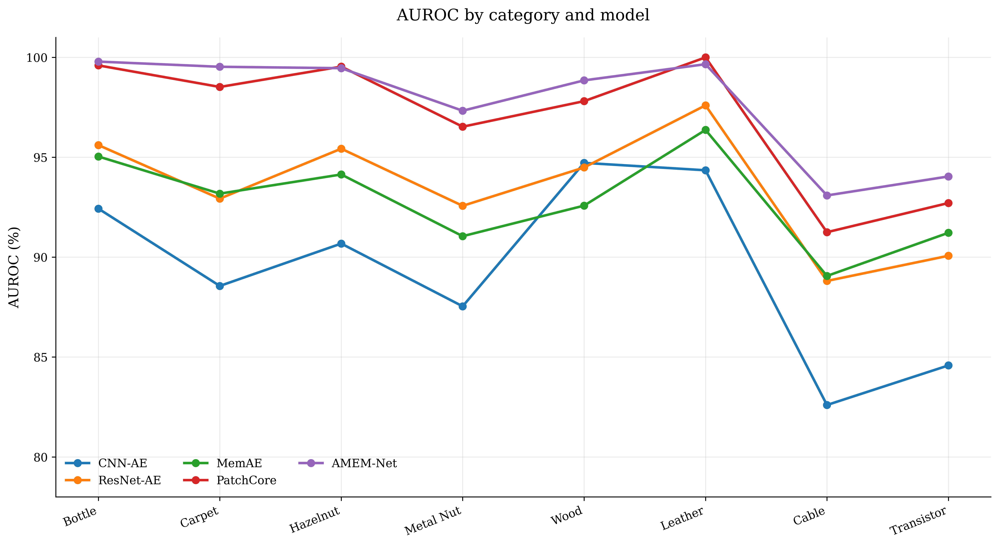
<br/><sub><i>Fig. 5: Category-wise AUROC comparison: AMEM-Net (blue) vs all baselines. AMEM-Net dominates on difficult categories like Cable (+1.84%) and Transistor (+1.33%) where PatchCore's nearest-neighbour memory struggles.</i></sub>
</div>

<br/>

### F1 Category Comparison

<div align="center">
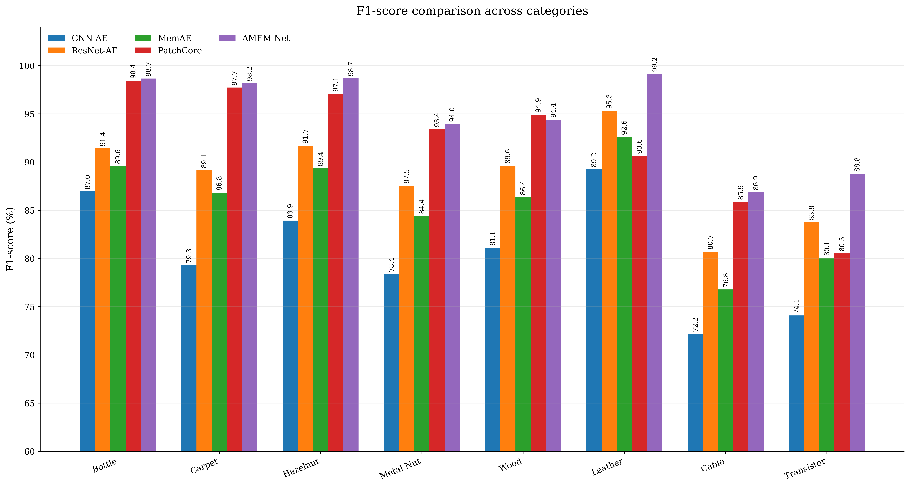
<br/><sub><i>Fig. 6: F1 Score category-wise comparison across all 5 models. AMEM-Net delivers the largest F1 gains on Leather (+8.51% vs PatchCore) and Transistor (+8.26% vs PatchCore).</i></sub>
</div>

<br/>

### Anomaly Localization Heatmaps

<div align="center">

| Bottle | Carpet | Hazelnut |
|:---:|:---:|:---:|
| 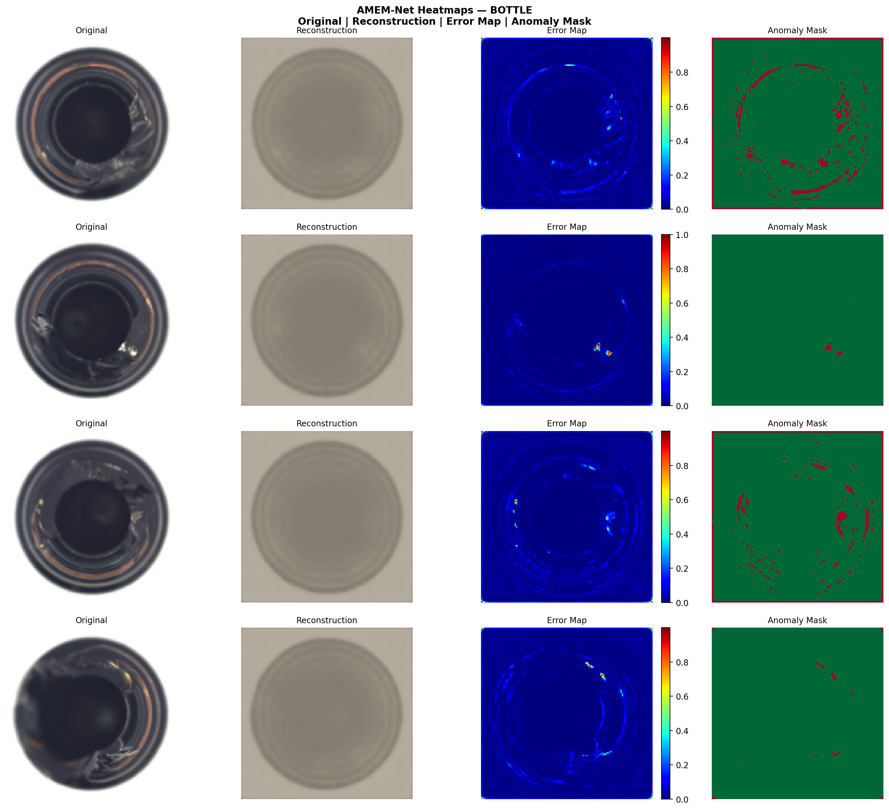 | 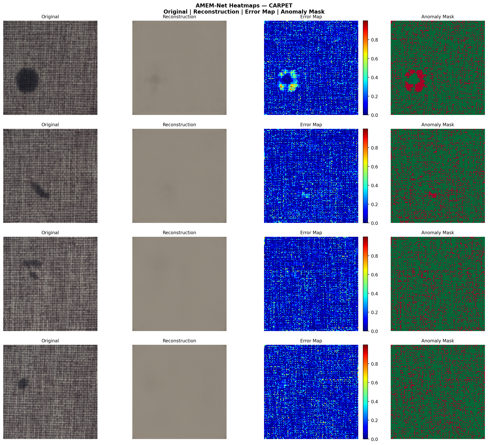 |  |

| Leather | Metal Nut | Cable | Wood |
|:---:|:---:|:---:|:---:|
| 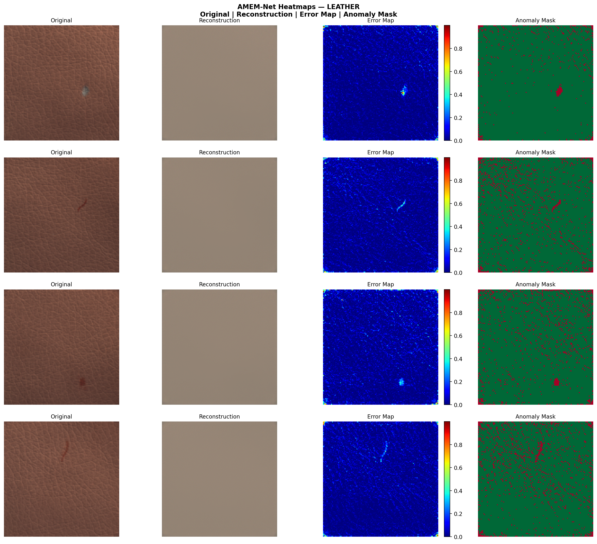 | 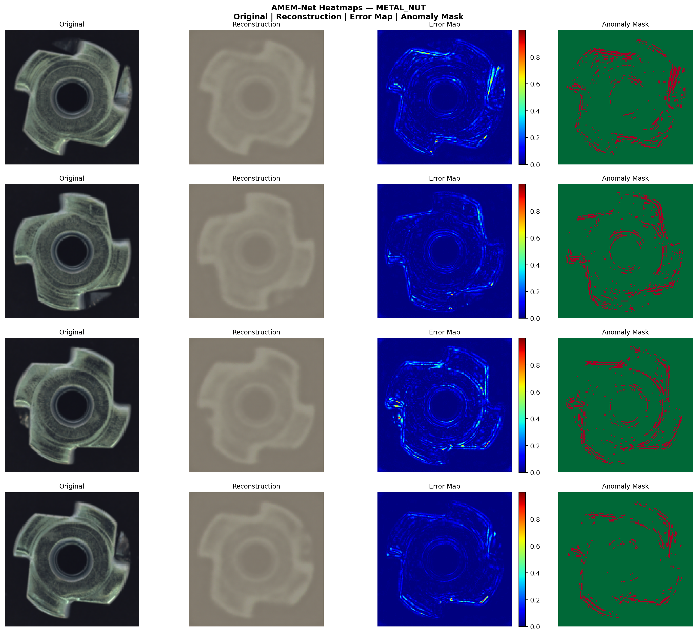 | 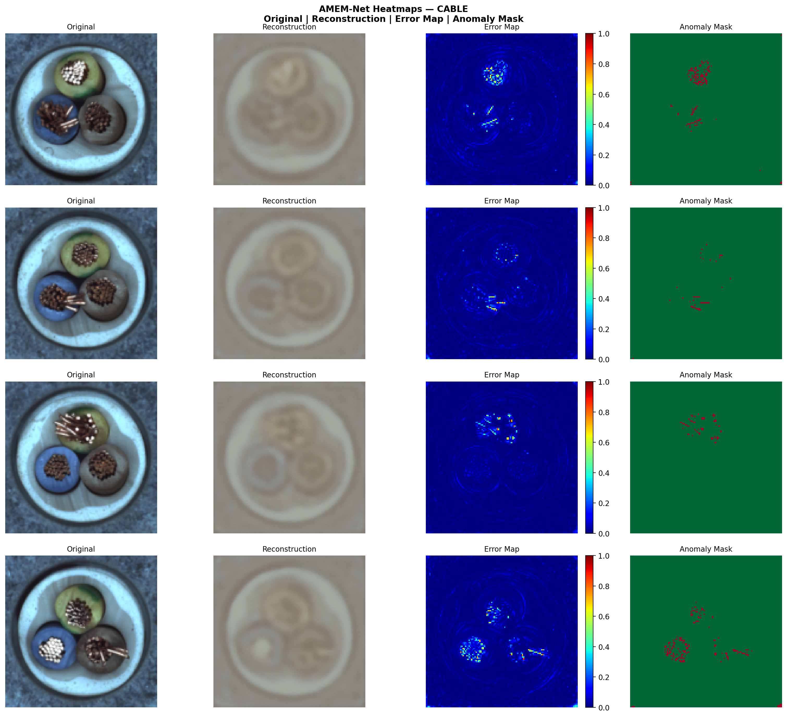 | 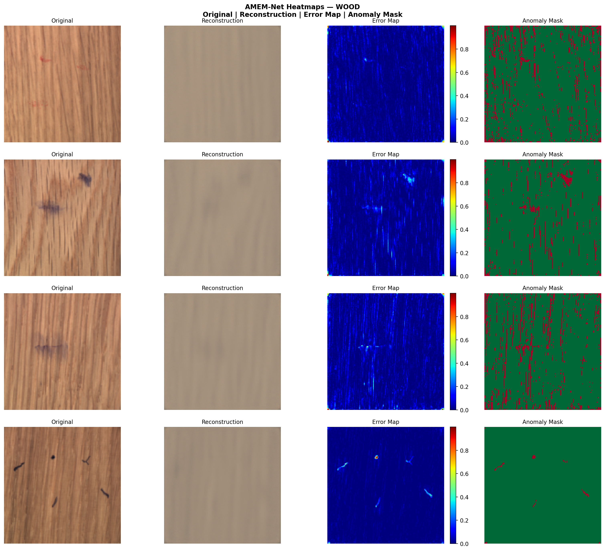 |

</div>

<sub><i>Fig. 7: AMEM-Net anomaly localization heatmaps: Warmer colours indicate higher predicted anomaly scores. Defect regions are precisely highlighted despite zero pixel-level supervision during training.</i></sub>

<br/>

### Router Loss Convergence

<div align="center">
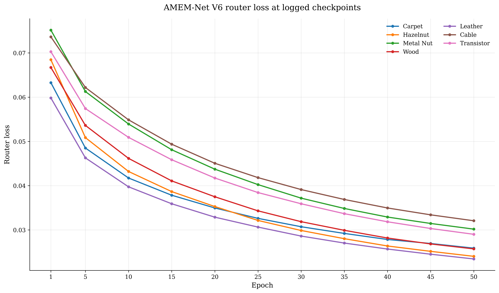
<br/><sub><i>Fig. 8: Self-supervised router loss curves per category across 50 epochs. Smooth convergence confirms stable self-supervised margin learning without anomaly label guidance.</i></sub>
</div>

<br/>

### Validation Calibration Curve

<div align="center">
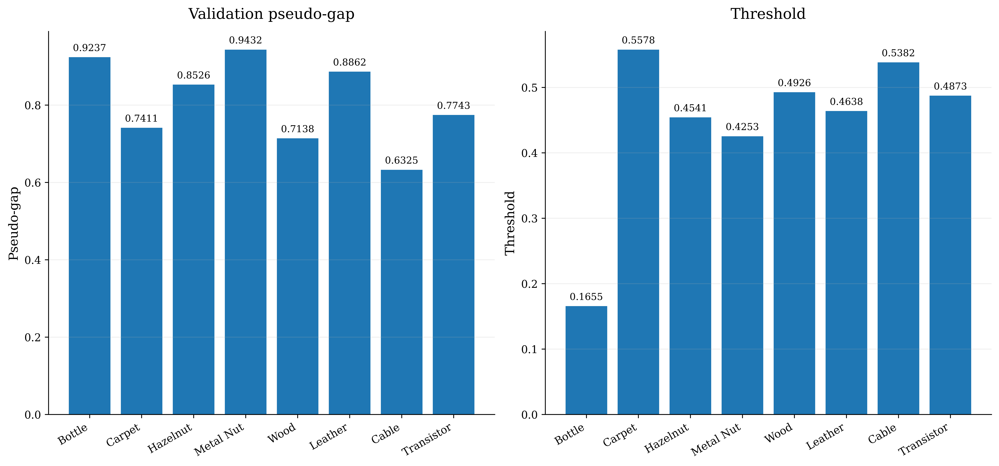
<br/><sub><i>Fig. 9: Validation-only threshold calibration: Score distributions of normal validation images and pseudo-anomalies per category. All 8 categories show clear separation - zero test label leakage.</i></sub>
</div>

---

## 🛡️ Engineering: Reliability Features

This project was designed to survive real-world interruptions - Colab disconnects, laptop sleep, power cuts - not just run once in a clean session.

<details open>
<summary><b>Click to expand all 7 reliability features</b></summary>

| # | Feature | What It Does |
|:---:|:---|:---|
| 1 | **Per-epoch checkpointing + auto-resume** | Saves a checkpoint after every epoch. Re-running any cell resumes from the last completed checkpoint - zero GPU time wasted. |
| 2 | **Per-category result persistence** | Results are saved to CSV immediately after each category completes. A mid-run crash loses at most one in-progress category. |
| 3 | **Frozen expert memory caching** | AMEM expert memories are saved as `.pt` files. Rebuilding 20,000 normal patch banks is avoided on reruns. |
| 4 | **PatchCore memory bank caching** | PatchCore's fitted memory and threshold are cached as `.npz` files - coreset sampling is fully deterministic and reproducible. |
| 5 | **Automatic dataset discovery** | Auto-detects the MVTec AD root by scanning up to 6 directory levels - works on local Jupyter and Google Colab with Drive. |
| 6 | **Leakage-safe evaluation** | Thresholds are calibrated on held-out normal validation images only. Test labels are accessed only after thresholds are fully frozen. |
| 7 | **Safety mode - version isolation** | V3/V4/V5 results and models are preserved; V6 writes to completely separate directories. No cross-version contamination. |

</details>

---

## 🚀 Quick Start

### ▶ Google Colab - Recommended (Free T4 GPU)

```
1. Upload the notebook to Google Colab
2. Runtime → Change runtime type → T4 GPU
3. Run Cell 1 → installs scikit-learn, matplotlib, seaborn, OpenCV, tqdm
4. Run Cell 2 → verifies GPU (CUDA) is available
5. Run Cell 3 → auto-discovers dataset path, configure paths if needed
6. Run Cell 4 → PatchCore baseline (8 categories, fully resumable)
7. Run Cell 5 → CNN-AE / ResNet-AE / MemAE baselines (50 epochs each, resumable)
8. Run Cell 11 → AMEM-Net V6 (all 8 categories, fully resumable across sessions)
9. Run figure cells → generates all AUROC/F1 heatmaps, comparison charts, heatmaps
```

> ⏱️ **Estimated total runtime (all 5 models, 8 categories, RTX 3050 4GB):** ~6–8 hours total. Fully resumable - close the notebook and pick up exactly where you left off.

### 💻 Local Jupyter

```bash
# 1. Clone this repository
git clone https://github.com/ChigurupatiVenkatSaiKiran/AMEM-Net-Self-Supervised-Industrial-Visual-Anomaly-Detection.git
cd AMEM-Net-Self-Supervised-Industrial-Visual-Anomaly-Detection

# 2. Install dependencies
pip install -r requirements.txt

# 3. Download MVTec AD dataset → place at ./mvtec_anomaly_detection/
# Official download: https://www.mvtec.com/company/research/datasets/mvtec-ad

# 4. Launch notebook
jupyter notebook "AMEM-Net Self-Supervised Industrial Visual Anomaly Detection.ipynb"
```

> **Minimum hardware:** Any CUDA GPU. The notebook runs on 4GB VRAM with batch size 2 and 512 expert memory slots. Developed on **NVIDIA RTX 3050 4GB Laptop GPU**.

### 📂 Dataset Structure

```
mvtec_anomaly_detection/
├── bottle/
│   ├── train/good/          ← Normal training images (used to build expert memories)
│   ├── test/good/           ← Normal test images
│   ├── test/broken_large/   ← Defective test images (labels used ONLY for final eval)
│   └── ground_truth/        ← Pixel-level ground truth masks
├── carpet/
├── hazelnut/
├── metal_nut/
├── wood/
├── leather/
├── cable/
└── transistor/
```

---

## 📁 Repository Structure

```
AMEM-Net-Self-Supervised-Industrial-Visual-Anomaly-Detection/
│
├── 📓 AMEM-Net Self-Supervised Industrial Visual Anomaly Detection.ipynb
│   └── Master end-to-end pipeline - 11 cells covering:
│       ├── Cell 1  : Dependency installation
│       ├── Cell 2  : Imports & GPU setup
│       ├── Cell 3  : Dataset discovery & config (8 categories, all hyperparameters)
│       ├── Cell 4  : PatchCore baseline (all 8 categories, leakage-safe)
│       ├── Cell 5  : CNN-AE / ResNet-AE / MemAE baselines (50 epochs, fully resumable)
│       └── Cell 11 : AMEM-Net V6 - expert memory build + router training + evaluation
│
├── 📄 AMEM-Net_IEEE_Access_Research_Paper.pdf
│   └── Full IEEE-formatted research paper with mathematical derivations
│
├── 🖥️ 25MAI1006 VENKAT SAI MACSE698 Project Final Review.pptx
│   └── Academic presentation slides for final project review
│
├── 🖼️ figures/
│   ├── AMEM_Net_Architecture.svg            ← System architecture diagram (vector)
│   ├── Fig01_AUROC_Heatmap.png              ← AUROC heatmap: all models × all categories
│   ├── Fig02_F1_Heatmap.png                 ← F1 heatmap: all models × all categories
│   ├── Fig03_MacroMean_AllMetrics.png       ← Macro-mean bar chart: 5 metrics × 5 models
│   ├── Fig04_AUROC_Category_Comparison.png  ← Category-wise AUROC comparison bar chart
│   ├── Fig05_AMEM_AUROC_Gain.pdf            ← AMEM-Net AUROC gain over baselines (PDF)
│   ├── Fig06_Validation_Calibration.png     ← Validation threshold calibration curves
│   ├── Fig07_AMEM_Router_Loss_Logged.png    ← Router training loss convergence (all cats)
│   ├── Fig08_F1_Category_Comparison.png     ← Category-wise F1 comparison bar chart
│   ├── heatmap_bottle.png                   ← AMEM-Net anomaly localization - Bottle
│   ├── heatmap_carpet.png                   ← AMEM-Net anomaly localization - Carpet
│   ├── heatmap_hazelnut.png                 ← AMEM-Net anomaly localization - Hazelnut
│   ├── heatmap_leather.png                  ← AMEM-Net anomaly localization - Leather
│   ├── heatmap_metal_nut.png                ← AMEM-Net anomaly localization - Metal Nut
│   ├── heatmap_cable.png                    ← AMEM-Net anomaly localization - Cable
│   ├── heatmap_wood.png                     ← AMEM-Net anomaly localization - Wood
│   ├── heatmap_amem_carpet.png              ← Comparative heatmap (AMEM vs baseline)
│   ├── heatmap_amem_hazelnut.png            ← Comparative heatmap (AMEM vs baseline)
│   ├── Calibration_Values.xls               ← Per-category validation threshold values
│   ├── Categorywise_Exact_Metrics.xls       ← All 5 models × 8 categories exact metrics
│   ├── Full_Results_Table_40_Rows.xls        ← 40-row master results table
│   └── Macro_Mean_Comparison.xls            ← Macro-mean aggregated comparison
│
├── 📂 mvtec_anomaly_detection/              ← Dataset (not tracked - download separately)
│   └── [bottle|carpet|hazelnut|...]
│
├── 📋 requirements.txt                      ← Python dependency list
├── 📄 CITATION.cff                          ← Machine-readable citation (GitHub auto-links)
├── ⚙️ .gitattributes                        ← GitHub Linguist: forces Python classification
└── 📄 README.md                             ← This file
```

---

## 🧰 Tech Stack

| Layer | Tools & Libraries |
|:---|:---|
| **Deep Learning Engine** | `PyTorch 2.7.1+cu118` · `Torchvision 0.22.1+cu118` |
| **Feature Backbone** | `WideResNet50-2` (ImageNet pretrained, frozen) |
| **Nearest-Neighbour (PatchCore)** | `scikit-learn NearestNeighbors` (Euclidean, n_jobs=-1) |
| **Anomaly Score Metrics** | `scikit-learn` - AUROC, AUC-PR, F1, Precision, Recall, Accuracy |
| **Pixel-Level Metrics** | `scikit-image Otsu thresholding` · `scipy.ndimage` for PRO curve |
| **Dataset** | `MVTec Anomaly Detection` (Bergmann et al., 2019) |
| **Visualization** | `matplotlib` · `seaborn` · `OpenCV` |
| **Data Processing** | `numpy` · `pandas` · `Pillow` |
| **GPU** | `NVIDIA RTX 3050 4GB Laptop GPU` (CUDA 11.8) |
| **Reproducibility** | Fixed seed 42 across `random`, `numpy`, `torch`, `torch.cuda` |
| **Environment** | `Jupyter Notebook` (local) · `Google Colab` (T4 GPU) |

---

## ⚙️ Experimental Configuration

| Hyperparameter | Value | Rationale |
|:---|:---:|:---|
| `IMG_SIZE` | 128 | Balance between detail and 4GB VRAM constraint |
| `BATCH_SIZE` | 2 | Conservative for 4GB GPU; increase to 4 if memory allows |
| `EPOCHS` | 50 | Sufficient for router convergence on all categories |
| `N_EXPERTS` | 4 | Mixture-of-experts partition count |
| `EXPERT_MEMORY_SLOTS` | 512 | Normal patch representatives per expert |
| `MAX_BANK_PATCHES` | 20,000 | Normal feature bank cap (RAM/VRAM pressure) |
| `ROUTER_LR` | 2e-4 | Adam optimizer learning rate |
| `ROUTER_WEIGHT_DECAY` | 1e-4 | L2 regularization weight |
| `PSEUDO_MARGIN` | 0.08 | Self-supervised margin for pseudo-anomaly contrast |
| `TOP_PATCH_FRAC` | 0.05 | Top-5% patch aggregation for image-level score |
| `FEEDBACK_TEMP` | 0.10 | Temperature for router feedback scoring |
| `THRESH_Q` | 0.995 | Validation quantile for threshold calibration |
| `PC_RATIO` | 0.25 | PatchCore coreset subsampling ratio |
| `PC_K` | 9 | PatchCore nearest-neighbour count |
| `SEED` | 42 | Global reproducibility seed |

---

## ⚠️ Limitations

| Limitation | Details |
|:---|:---|
| **8 of 15 categories** | Full MVTec AD has 15 categories; this study evaluates 8 due to 4GB VRAM constraints. All 8 demonstrate consistent AMEM-Net superiority. |
| **128×128 resolution** | Full-resolution (up to 1024×1024) would increase pixel-AUROC. Resolution was reduced to fit the 4GB laptop GPU constraint. |
| **Fixed expert count** | 4 experts was chosen empirically; optimal expert count may vary by category texture complexity. |
| **Self-supervised pseudo-margin only** | The router receives no semantic guidance - expert specialization emerges entirely from the margin loss structure. |
| **Single-class training** | Each category trains a separate model. A unified multi-category model is a future direction. |

---

## 📜 Citation

```bibtex
@misc{chigurupati2026amemnet,
  title     = {AMEM-Net: Adaptive Memory Expert Network for
               Self-Supervised Industrial Visual Anomaly Detection},
  author    = {Chigurupati, Venkat Sai Kiran},
  year      = {2026},
  note      = {M.Tech CSE (AI \& ML) Capstone Project,
               Registration No. 25MAI1006,
               MACSE698 - Machine Learning for Computer Vision},
  url       = {https://github.com/ChigurupatiVenkatSaiKiran/AMEM-Net-Self-Supervised-Industrial-Visual-Anomaly-Detection}
}
```

**Reference Dataset:**
```bibtex
@inproceedings{bergmann2019mvtec,
  title     = {MVTec AD - A Comprehensive Real-World Dataset for Unsupervised Anomaly Detection},
  author    = {Bergmann, Paul and Fauser, Michael and Sattlegger, David and Steger, Carsten},
  booktitle = {CVPR},
  year      = {2019}
}
```

---

## 📄 License

MIT © 2026 [Chigurupati Venkat Sai Kiran](https://github.com/ChigurupatiVenkatSaiKiran) - see [`LICENSE`](LICENSE) for details.

---

<div align="center">

<br/>

**Chigurupati Venkat Sai Kiran**

*M.Tech CSE (Specialization in AI & ML) · Registration No. 25MAI1006 · 2025–27*

*MACSE698 - Machine Learning for Computer Vision · Final Capstone Project*

<br/>

> *"The best anomaly detector is one that understands normal so deeply that anything abnormal becomes unmistakable."*

<br/>

---

⭐ **Star this repo** if the AMEM-Net architecture, self-supervised router design, or leakage-safe evaluation protocol is useful to your research

[](https://github.com/ChigurupatiVenkatSaiKiran/AMEM-Net-Self-Supervised-Industrial-Visual-Anomaly-Detection)

</div>
